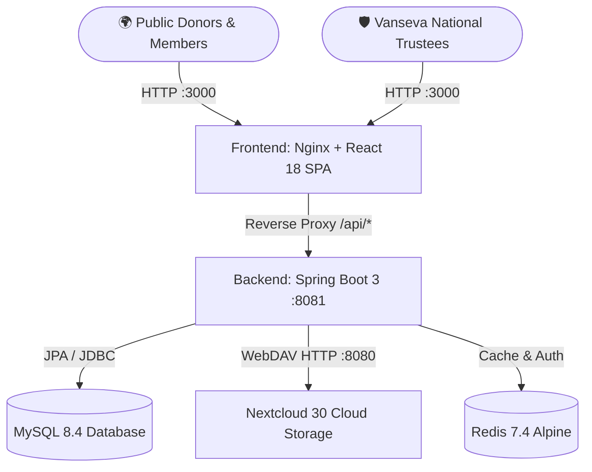

# 🌱 Vanseva — Green Earth & Plantation Management System

> Enterprise-grade NGO plantation management and eco-stewardship platform with private cloud document storage powered by Nextcloud WebDAV.

---

## 🌟 Key Features

- 🌲 **Tree Sponsorship & Donation Engine**: Sponsoring indigenous tree saplings across verified afforestation campaigns, live cost calculations, and bank reconciliation.
- 📜 **Automated 80G PDF Receipts**: Real-time generation of tax-deductible donation receipts with cryptographic hashes, archived automatically into Nextcloud private storage.
- 🛡️ **Eco-Guardian Memberships**: Multi-tier community membership registration with environmental interest tagging and digital membership cards.
- ☁️ **Nextcloud WebDAV Cloud Storage**: Secure, private on-premise cloud storage integration for receipts, payment proofs, plantation photos, and campaign banners.
- 📸 **Geotagged Plantation Gallery**: Visual photo moderation and community showcase of afforestation progress across India.
- 🔐 **Role-Based Access Control**: Secure JWT + Cookie authentication distinguishing Trustees/Administrators and Eco-Guardian Members.
- 📋 **Immutable Audit Trail**: Transparent logging of every security, donation, and membership event.

---

## 🏗️ Architecture & Technology Stack

| Layer | Technologies |
| :--- | :--- |
| **Frontend** | React 18, TypeScript, Vite, Vanilla CSS Design System, Lucide React Icons |
| **Backend API** | Java 21, Spring Boot 3.3.4, Spring Security 6, Spring Data JPA, OpenPDF |
| **Databases** | MySQL 8.4 (Core transactional store), MariaDB 10.11 (Nextcloud metadata) |
| **Cache & Sessions**| Redis 7.4 Alpine |
| **Private Cloud** | Nextcloud 30.0.4 (Enterprise WebDAV integration) |
| **Containerization**| Docker Compose, Multi-stage Docker builds, Alpine Nginx |



---

## ⚡ Quick Start with Docker

### Prerequisites
- Docker Engine & Docker Compose
- Shared Docker network: `cch-network` (or existing container cluster)

### 1. Configure Environment
Copy the sample environment file:
```bash
cp .env.example .env
```

### 2. Start Services
```bash
docker compose up -d --build
```

### 3. Verify Health
- **Frontend**: [http://localhost:3000](http://localhost:3000)
- **Backend API Health**: [http://localhost:8081/actuator/health](http://localhost:8081/actuator/health)
- **Nextcloud Storage**: [http://localhost:8080](http://localhost:8080)

---

## 🛠️ Local Development Setup

### Backend (Spring Boot)
```bash
cd backend
mvn clean spring-boot:run
```
Backend runs at `http://localhost:8081`.

### Frontend (React + Vite)
```bash
cd frontend
npm install
npm run dev
```
Frontend runs at `http://localhost:3000` with hot-reload and proxy to `http://localhost:8081`.

---

## 🔑 Default Credentials

| Role | Username | Password | Access Rights |
| :--- | :--- | :--- | :--- |
| **Primary Administrator** | `admin` | `Admin@Vanseva2026` | Full Admin Dashboard, reconciliation, Nextcloud diagnostics, audit logs |
| **Sample Eco-Guardian** | `priya.sharma` | `Member@Vanseva2026` | Member Portal, donation history, PDF receipt downloads |

---

## 📂 Nextcloud Cloud Storage Directory Hierarchy

All files stored through the platform are managed under the `Vanseva` root directory in Nextcloud:

```text
Nextcloud/
└── Vanseva/
    ├── Campaigns/            # Campaign promotional banners & site documents
    ├── DonationDocuments/    # Donor payment proofs and bank transfer receipts
    ├── DonationReceipts/     # Generated 80G tax-deductible PDF receipts
    ├── Memberships/          # Eco-Guardian membership applications and KYC proofs
    └── PlantationImages/     # Moderated high-resolution plantation site photographs
```

---

## 📡 REST API Reference

| Endpoint | Method | Access | Description |
| :--- | :--- | :--- | :--- |
| `/api/auth/login` | `POST` | Public | Authenticate user & issue session token/cookie |
| `/api/auth/register` | `POST` | Public | Register new Eco-Guardian member with profile |
| `/api/auth/me` | `GET` | Authenticated | Current authenticated user profile |
| `/api/campaigns` | `GET` | Public | List active tree plantation campaigns |
| `/api/donations/pledge` | `POST` | Public/Auth | Create tree sponsorship or donation pledge |
| `/api/donations/my-donations` | `GET` | Member | Retrieve user's pledge and donation history |
| `/api/donations/{id}/receipt/download` | `GET` | Owner/Admin | Download official 80G PDF receipt from Nextcloud |
| `/api/gallery` | `GET` | Public | View approved geotagged plantation photos |
| `/api/admin/overview-stats` | `GET` | Admin | Comprehensive operational analytics |
| `/api/admin/donations/{id}/verify` | `POST` | Admin | Reconcile donation & generate Nextcloud PDF receipt |
| `/api/admin/storage/health` | `GET` | Admin | Live Nextcloud WebDAV ping, latency & folder check |
| `/api/admin/audit-logs` | `GET` | Admin | Immutable security & system audit log trail |

---

## 📜 License & NGO Compliance

Vanseva is developed for non-profit environmental conservation and green canopy expansion. Built in accordance with Indian Society Registration and Section 80G statutory donation documentation requirements.
